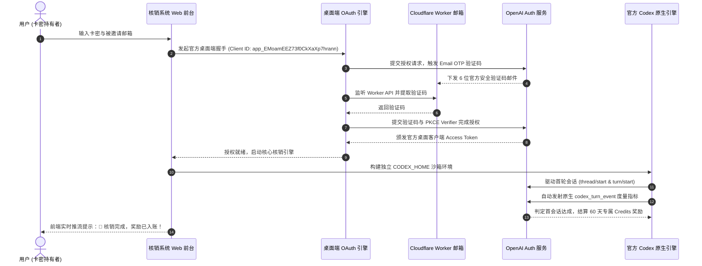

# OpenAI Codex & GPT 邀请奖励全自动核销与卡密分发管理系统 (openai-codex-referral)

<p align="center">
  
  
  
  
  
  <a href="https://cdxinvite.aicheap.pro" target="_blank"></a>
</p>

> 🌐 **在线体验站点 (Live Demo)**: [https://cdxinvite.aicheap.pro](https://cdxinvite.aicheap.pro)  
> 🏷️ **关键词 (Keywords)**: `GPT 邀请奖励` | `Codex 邀请奖励` | `OpenAI 邀请奖励` | `OpenAI 推荐朋友` | `Codex 邀请` | `GPT 邀请` | `ChatGPT Referral` | `OpenAI Credits` | `卡密分发核销` | `全自动接码核销`

一套专为 **GPT / OpenAI Codex 推荐朋友邀请奖励（Credits / 额度返利）** 设计的高性能全自动化核销与卡密分发管理系统。
系统深度逆向并模拟了官方 **Codex Desktop** 桌面客户端的 OAuth 2.0 PKCE 认证握手与原生 Rust 引擎推理流程，无缝串联 Cloudflare Worker 临时邮箱自动收信取码、智能风控探测与卡密分发体系，彻底解决 GPT / Codex 邀请奖励无法到账、桌面端手工核销繁杂的痛点，实现端到端 100% 全自动化核销入账。

---

## ✨ 核心特性

- 🚀 **官方 Codex 原生引擎驱动**：通过本地沙箱调用官方独立 `codex` 运行时（app-server 模式），建立原生会话管道并上报具备真实推理度量的 `codex_turn_event` 原生事件，保障推荐奖励额度 100% 成功结算至邀请人账户。
- 🔐 **官方桌面端 OAuth 授权引擎**：完整实现官方桌面端（`Client ID: app_EMoamEEZ73f0CkXaXp7hrann`）免密邮箱验证码（Email OTP）与密码混合登录链路，直换具备 `offline_access` 权限的官方 Desktop Token。
- 📬 **Cloudflare Worker 邮箱实时取信**：深度对接 Cloudflare Email Worker API，全自动秒级轮询捕获最新 6 位数字验证码，规避各种邮件头与垃圾报文误判。
- 🧪 **账号双向验活 & 手机绑定探测**：智能探测被邀请账号在 OpenAI 服务端的健康状态（存活、封禁停用、未注册）及是否要求接码绑定手机（`add_phone`）。
- 💳 **现代化卡密兑换前台**：极简高颜值的兑换终端，集成 Server-Sent Events (SSE) 全程可视化流式日志推流、60 天冷冻期保护与防刷风控。
- 📊 **全功能 Admin 后台仪表盘**：涵盖卡密批量生成/导出、邮箱库存生命周期管理、Worker 邮箱批量同步/缓存移出、慢速防风控巡检调度及系统全局参数热配置。
- 🐳 **容器化一键部署**：内置 Dockerfile 与 docker-compose 配置，跨平台开箱即用。

---

## 🏗️ 架构与核销流程



---

## 📁 目录结构

```text
openai-codex-referral/
├── web_server.py           # Starlette/Uvicorn 异步 Web 核心服务与 API 路由
├── oauth_client.py         # Codex Desktop 官方客户端 OAuth 认证与邮件提取引擎
├── referral_activator.py   # 官方原生 Codex Desktop 首会话核销引擎 (Step 1-7)
├── database.py             # SQLite 数据模型、卡密、库存与巡检持久化
├── auth_utils.py           # 辅助加解密、JWT 校验与指纹处理
├── sms_countries.json      # 接码平台国家区号映射表
├── templates/
│   ├── index.html          # 前台卡密兑换页面 (实时流式任务推流)
│   └── admin.html          # 管理后台仪表盘 (卡密/库存/Worker/自动巡检/配置)
├── scripts/
│   ├── setup_codex.sh      # 官方 Linux 独立 Codex 引擎一键拉取脚本
│   ├── start_server.sh     # 生产环境后台启动脚本
│   └── stop_server.sh      # 服务平滑终止脚本
├── data/                   # 本地持久化数据库目录 (.gitkeep)
├── Dockerfile              # Docker 镜像构建配置
├── docker-compose.yml      # Docker Compose 一键启动配置
├── requirements.txt        # Python 依赖清单
├── .env.example            # 环境变量配置模板
├── .gitignore              # 严格的代码与敏感数据过滤清单
└── LICENSE                 # MIT 开源协议
```

---

## 🚀 快速开始

### 方式一：Docker Compose（推荐）

1. **克隆仓库**
   ```bash
   git clone https://github.com/your-username/openai-codex-referral.git
   cd openai-codex-referral
   ```

2. **配置环境变量**
   ```bash
   cp .env.example .env
   # 根据实际环境修改 .env 中的后台密码、Worker 地址等参数
   vim .env
   ```

3. **一键启动**
   ```bash
   docker-compose up -d --build
   ```

4. **访问系统**
   - 前台兑换页：`http://localhost:8080/`
   - 管理后台：`http://localhost:8080/admin-secret-dashboard`（默认密码：`admin123456`，可在 `.env` 中自定义路径与密码）

---

### 方式二：Linux / macOS / WSL 原生部署

1. **准备 Python 环境**
   ```bash
   python3 -m venv venv
   source venv/bin/activate
   pip install -r requirements.txt
   ```

2. **拉取官方 Codex 原生独立引擎**
   ```bash
   bash scripts/setup_codex.sh
   ```
   > 脚本会自动从官方源拉取 `rust-v0.160.0` 独立二进制并配置执行权限。

3. **启动后台服务**
   ```bash
   # 测试前台启动
   python3 web_server.py --host 0.0.0.0 --port 8080

   # 或通过脚本后台守护启动
   bash scripts/start_server.sh
   ```

---

## ⚙️ 核心配置参数 (.env)

| 参数名 | 默认值 | 说明 |
| :--- | :--- | :--- |
| `PORT` | `8080` | Web 服务监听端口 |
| `HOST` | `0.0.0.0` | 监听地址 |
| `ADMIN_PASSWORD` | `admin123456` | 管理后台管理员登录密码 |
| `ADMIN_PATH` | `admin-secret-dashboard` | 后台访问自定义安全路径前缀 |
| `DEFAULT_ACCOUNT_PASSWORD` | `ChangeMePassword123!@` | 自动入库或注册时的默认初始密码 |
| `WORKER_URL` | `https://your-worker-email-domain.com` | Cloudflare Email Worker 接口地址 |
| `WORKER_ADMIN_AUTH` | `YourWorkerAdminSecret` | Worker `x-admin-auth` 鉴权密码 |
| `WORKER_DOMAIN` | `example.com` | 支持的 Worker 域名后缀清单 |
| `DEFAULT_PROXY` | 空 | 全局出口代理（格式：`http://user:pass@ip:port` 或 `socks5://...`） |
| `SMS_PROVIDER` | `5sim` | 短信风控接码提供商（支持 `5sim`、`hero_sms`、`sms_online`） |
| `SMS_API_KEY` | 空 | 接码平台 API Key |

---

## 🔒 安全建议与最佳实践

1. **修改默认凭证**：请在上线第一时间修改 `.env` 中的 `ADMIN_PASSWORD` 与 `ADMIN_PATH`。
2. **配置住宅出口代理**：因 OpenAI 对数据中心 IP 存在 Cloudflare/Sentinel 限制，建议为 `DEFAULT_PROXY` 配备优质住宅或移动代理。
3. **频率控制**：后台巡检和批量检测默认已内置随机延时防风控算法（15~40 秒波动），建议单次批量注册或连续检测不超过 20 个。

---

## 📄 免责声明 (Disclaimer)

- 本项目仅供软件工程、API 架构逆向研究与自动化测试学习交流使用。
- 请在遵守当地法律法规及目标服务商服务条款的前提下使用本项目。
- 作者不对使用本软件所产生的任何间接或直接损失承担责任。

---

## 📜 开源协议

本项目采用 [MIT 许可证](LICENSE) 开源。欢迎提交 Issue 与 Pull Request！
